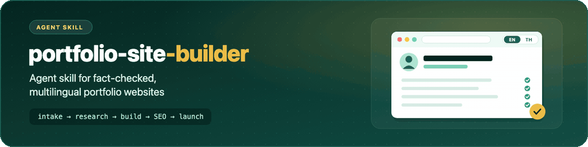
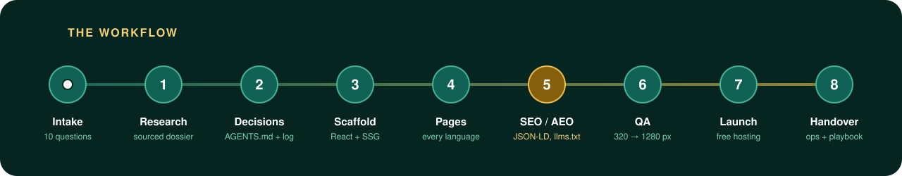
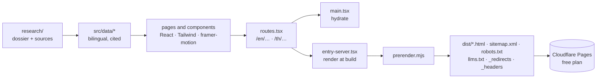

<p align="center">
  <picture>
    <source media="(prefers-reduced-motion: reduce) and (prefers-color-scheme: dark)" srcset="assets/banner-dark.svg">
    <source media="(prefers-reduced-motion: reduce)" srcset="assets/banner-light.svg">
    
  </picture>
</p>

<p align="center">
  <a href="#install"></a>
  <a href="#install"></a>
  <a href="#install"></a>
  <a href="LICENSE"></a>
</p>

<p align="center">
  <b>Interview the person → verify every fact → build a pre-rendered, multilingual site → make search engines and AI assistants quote it correctly → host it for free.</b>
</p>

---

## Why this skill

Most AI-built portfolio sites look fine and are quietly wrong: a rounded-up number, a title that changed two years ago, a "world-leading" nobody said, a phone number that should never have been public, a page that crawlers see as empty.

This skill comes from building and launching a real 30-page, two-language academic portfolio. Every rule in it is a mistake that was made once and fixed.

<table>
<tr>
<td width="33%" valign="top">

### 🔎 Facts with receipts
Every claim on the site traces back to a URL or a document, marked ✅ confirmed, 🟡 CV only or ❓ hidden until confirmed.

</td>
<td width="33%" valign="top">

### 🌏 Truly multilingual
A URL for each language, hreflang, a `t({ en, th })` helper on every string, and line breaking for languages without spaces that doesn't hide names from search.

</td>
<td width="33%" valign="top">

### 🤖 Built for answer engines
Pre-rendered HTML, JSON-LD, a visible answer-first facts block, `llms.txt`, a sitemap with alternates and IndexNow.

</td>
</tr>
<tr>
<td valign="top">

### 🛡️ Privacy by default
A "what must never appear" question before any research starts, plus rules for students and staff, photo rights and press photos.

</td>
<td valign="top">

### 🎨 Professional, then playful
Design tokens, a page catalogue, motion rules that respect reduced motion, and optional animated characters only where the person allows them.

</td>
<td valign="top">

### 🆓 Free to run
Static output on Cloudflare Pages' free plan, with publish and rollback steps, the free-plan limits, and monthly and yearly checklists.

</td>
</tr>
</table>

## Who it might suit

It may be useful if you are:

- **an academic or researcher** who wants one page that lists their publications, students and projects correctly, in more than one language;
- **a family member, student or assistant** building a site for someone else and needing a way to check facts and get their approval;
- **a university office or research group** making profile sites for several people in the same format;
- **a professional or executive** whose public record is spread over news items, institution pages and an old CV;
- **a developer** who likes the pattern (pre-rendered React, URLs per language, structured data) and wants it written down for an AI agent to follow.

It is probably more than you need for a one-page résumé, or for a site that will never be in a second language. In that case, the intake questions and the research method may still help.

<p align="center">
  
</p>

## It starts with 10 questions

Before writing a line of code, the agent asks:

| # | Question | Shapes |
|:-:|---|---|
| 1 | **Who is it about, and who is building it?** Every name form, how they want to be addressed, who approves facts | Copy, titles, structured data |
| 2 | **What is it for, and who should it reach?** And what must it *not* offer | Calls to action, contact topics |
| 3 | **Which languages, and which comes first?** Register, calendar conventions | URLs, hreflang, fonts |
| 4 | **Where do the facts come from?** CV, profiles, IDs, news, permission to research | The research pipeline |
| 5 | **What pages and features?** Ranked | Navigation, build order |
| 6 | **What must never appear?** | Privacy rules |
| 7 | **How should it sound and feel?** | Tone, playful elements |
| 8 | **What should it look like?** Brand, references, photos and their owners | Design tokens, photo rules |
| 9 | **What should a search engine or AI assistant say about them?** | Facts block, FAQ schema, `llms.txt` |
| 10 | **Domain, hosting, budget, upkeep?** | Host, editing model, redirects |

The full wording, with why each one matters, is in [`references/intake-questions.md`](references/intake-questions.md).

## How the site is built



**Stack:** Vite · React 19 · TypeScript · Tailwind 3 · React Router 7 · framer-motion · build-time pre-rendering with `react-dom/static`. No backend. Want something different (a CMS for a non-coder, one language, Astro)? The skill **asks first**, then offers options from [`architecture-options.md`](references/architecture-options.md).

## Install

<details open>
<summary><b>Claude Code</b></summary>

```bash
git clone https://github.com/Worakornk/portfolio-site-builder ~/.claude/skills/portfolio-site-builder
```
Then ask: *"Build a portfolio site for …"*. The skill triggers from its description.
</details>

<details>
<summary><b>OpenAI Codex</b></summary>

```bash
git clone https://github.com/Worakornk/portfolio-site-builder ~/.codex/skills/portfolio-site-builder
```
</details>

<details>
<summary><b>Gemini CLI · Cursor · GitHub Copilot · any agent that reads AGENTS.md</b></summary>

```bash
git clone https://github.com/Worakornk/portfolio-site-builder skills/portfolio-site-builder
```
Add this line to your project's `AGENTS.md` (or `GEMINI.md`, `.cursor/rules`, `.github/copilot-instructions.md`):
```text
For portfolio-site work, follow skills/portfolio-site-builder/SKILL.md and load its references as each phase needs them.
```
</details>

Each project the skill builds writes its own `AGENTS.md` too, so whichever agent opens that project next follows the same rules.

## What's inside

```text
portfolio-site-builder/
├── SKILL.md                          ← workflow, non-negotiable rules, pitfalls (start here)
└── references/
    ├── intake-questions.md           the 10 questions and what each answer controls
    ├── data-gathering.md             Crossref, OpenAlex, ORCID, thesis catalogues, awards, press, photos
    ├── project-docs.md               AGENTS.md, decision log, open items, research file templates
    ├── architecture.md               i18n routing, pre-rendering, head/SEO layer, images, hosting
    ├── ux-ui-style.md                tokens, page catalogue, copy, motion, photos, accessibility
    ├── seo-aeo.md                    metadata, JSON-LD, facts block, llms.txt, search tools
    ├── operations.md                 QA checklist, launch, staying free, publishing, upkeep
    └── architecture-options.md       opt-in variations, offered only on request
```

## Pitfalls it saves you from

| ❌ What went wrong | ✅ What the skill does instead |
|---|---|
| Client-only SPA: crawlers saw an empty page | Pre-render every page at build time |
| Invisible word-joiner characters hid the person's name from search | No-wrap spans from a custom JSX runtime; clean text |
| A JS-animated hero was invisible in the HTML | CSS entrance above the fold |
| A "sooner" statistic became "more accurate", then got rounded up | Quote what the source measured |
| Several agents in one folder committed each other's files | Build the exact commit in a clean worktree before pushing |
| A second "v2" redesign wasted a day | One design, improved in place |

## Contributing

Issues and pull requests are welcome, especially new data sources for other countries' thesis catalogues and award registries, and line-breaking word lists for other languages. Keep the skill free of personal details about anyone.

## License

[MIT](LICENSE)
